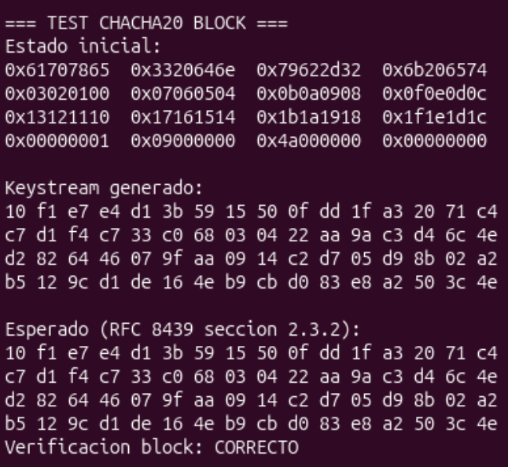
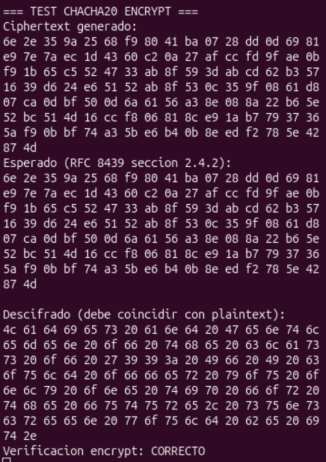

# ChaCha20 en RISC-V

## Introducción

Este proyecto consiste en la implementación del algoritmo de cifrado **ChaCha20** utilizando ensamblador **RISC-V**, integrándolo con un programa principal desarrollado en lenguaje **C**.

El objetivo principal es demostrar la correcta implementación de algoritmos criptográficos a bajo nivel, aplicando conceptos fundamentales de arquitectura de computadoras como manejo de registros, convenciones de llamada, uso del *stack* e integración entre **C** y ensamblador.

La implementación incluye el desarrollo de las funciones principales del algoritmo: `chacha20_quarter_round`, `chacha20_block` y `chacha20_encrypt`, las cuales permiten generar el *keystream* y realizar el cifrado y descifrado de mensajes de longitud arbitraria. La corrección del algoritmo se verifica mediante los vectores de prueba oficiales del **RFC 8439**, asegurando que los resultados coincidan exactamente con la especificación.

El proyecto se desarrolla dentro de un entorno **RISC-V** utilizando **QEMU**, **Docker** y **GDB**, permitiendo la compilación, ejecución y depuración del código. Además, se siguen buenas prácticas de desarrollo mediante el uso de **Git**, incluyendo desarrollo incremental por *branches*, commits estructurados y documentación técnica del diseño e implementación.

## Estructura del proyecto

El repositorio se encuentra organizado de manera modular, separando el código fuente, pruebas, documentación y archivos del entorno de ejecución. Esta organización permite mantener una clara separación entre la implementación del algoritmo, los archivos de soporte del entorno RISC-V y los materiales de referencia proporcionados.

```text
rvqemu/
├── Dockerfile          # Define el entorno Docker utilizado para compilar y ejecutar el proyecto.
├── run.sh              # Script principal para construir y ejecutar el proyecto dentro del entorno QEMU.
├── README.md           # Documentación general del proyecto e instrucciones de uso.
├── DOCUMENTACION.md    # Documentación técnica del diseño e implementación.
├── chacha20.elf        # Ejecutable final generado tras la compilación.
│
├── src/                # Código fuente principal del proyecto.
│   ├── chacha20_asm.S  # Implementación en ensamblador RISC-V del algoritmo ChaCha20.
│   ├── chacha20.h      # Definición de interfaces entre C y ensamblador.
│   ├── main.c          # Programa principal encargado de probar el cifrado y descifrado.
│   ├── startup.s       # Código de inicialización necesario para el entorno bare-metal.
│   ├── linker.ld       # Script del linker para la generación del ejecutable.
│   ├── chacha20.o      # Archivo objeto generado a partir del código ensamblador.
│   ├── main.o          # Archivo objeto generado a partir del programa principal.
│   └── startup.o       # Archivo objeto del código de inicialización.
│
├── tests/              # Casos de prueba del algoritmo.
│   └── test_quarter_round.c  # Prueba unitaria del quarter round usando vectores RFC.
│
├── docs/               # Carpeta reservada para evidencias de ejecución (capturas GDB/QEMU).
│
└── examples/           # Ejemplos base proporcionados en el repositorio del curso.
    ├── asm-only/       # Ejemplo de programa únicamente en ensamblador.
    ├── c-asm/          # Ejemplo de integración entre C y ensamblador.
    └── README.md       # Descripción de los ejemplos incluidos.
```

## Requisitos previos

Para poder construir, ejecutar y depurar este proyecto es necesario contar con los siguientes requisitos en la máquina *host*:

- Git: para clonar y gestionar el repositorio.
- Docker: el proyecto se ejecuta dentro de un contenedor.
- Sistema operativo: debe ser compatible con contenedores (Linux o el equivalente que permita ejecutar Docker).

No es necesario instalar manualmente la *toolchain* de RISC-V, QEMU o GDB, ya que estas dependencias se encuentran configuradas dentro del contenedor definido en el **Dockerfile**. Este entorno incluye:

- Compilador `gcc-riscv64-unknown-elf`
- `gdb-multiarch` para depuración
- QEMU con soporte para arquitecturas RISC-V
- Herramientas de compilación necesarias

El script `run.sh` detecta automáticamente si el sistema utiliza Docker, construye la imagen del contenedor si es necesario y abre una terminal interactiva dentro del entorno configurado para el desarrollo del proyecto.

El presente proyecto utiliza como base el repositorio suministrado por el profesor, el cual provee la infraestructura necesaria para el desarrollo en RISC-V.

## Construcción y ejecución del proyecto

A continuación, se describen los pasos necesarios para construir y ejecutar el proyecto dentro del entorno Docker proporcionado.

1. Ingresar al directorio del proyecto:
```bash
cd ~/Documents/PIArqui1/rvqemu
```

2. Iniciar el entorno Docker:
```bash
./run.sh
```

3. Abrir una segunda terminal dentro del contenedor:
```bash
docker exec -it rvqemu /bin/bash
```

4. Posicionarse en el directorio de trabajo:
```bash
cd /home/rvqemu-dev/workspace
```

5. Compilar el proyecto:

    a. Archivo de inicio:
    ```bash
    riscv64-unknown-elf-gcc -march=rv32im -mabi=ilp32 \
      -nostdlib -ffreestanding -g3 -gdwarf-4 \
      -c src/startup.s -o src/startup.o
    ```

    b. Programa principal:
    ```bash
    riscv64-unknown-elf-gcc -march=rv32im -mabi=ilp32 \
      -nostdlib -ffreestanding -g3 -gdwarf-4 \
      -c src/main.c -o src/main.o
    ```

    c. Implementacion del algoritmo ChaCha20:
    ```bash
    riscv64-unknown-elf-gcc -march=rv32im -mabi=ilp32 \
      -nostdlib -ffreestanding -g3 -gdwarf-4 \
      -c src/chacha20_asm.S -o src/chacha20.o
    ```

6. Generar el ejecutable:
```bash
riscv64-unknown-elf-gcc -march=rv32im -mabi=ilp32 \
  -nostdlib -ffreestanding -g3 -gdwarf-4 \
  src/startup.o src/main.o src/chacha20.o \
  -T src/linker.ld -o chacha20.elf
```

7. Ejecutar el programa en QEMU:
```bash
qemu-system-riscv32 \
  -machine virt \
  -nographic \
  -bios none \
  -kernel chacha20.elf
```

Ejecución rápida:
```bash
./run.sh
docker exec -it rvqemu /bin/bash
cd /home/rvqemu-dev/workspace

# Compilación
riscv64-unknown-elf-gcc -march=rv32im -mabi=ilp32 -nostdlib -ffreestanding -g3 -gdwarf-4 \
  -c src/startup.s -o src/startup.o
riscv64-unknown-elf-gcc -march=rv32im -mabi=ilp32 -nostdlib -ffreestanding -g3 -gdwarf-4 \
  -c src/main.c -o src/main.o
riscv64-unknown-elf-gcc -march=rv32im -mabi=ilp32 -nostdlib -ffreestanding -g3 -gdwarf-4 \
  -c src/chacha20_asm.S -o src/chacha20.o

# Link
riscv64-unknown-elf-gcc -march=rv32im -mabi=ilp32 -nostdlib -ffreestanding -g3 -gdwarf-4 \
  src/startup.o src/main.o src/chacha20.o -T src/linker.ld -o chacha20.elf

# Run
qemu-system-riscv32 -machine virt -nographic -bios none -kernel chacha20.elf
```

## Ejecución de pruebas y verificación con los vectores del RFC

Para verificar el correcto funcionamiento de la implementación del algoritmo **ChaCha20**, se utilizaron los vectores de prueba oficiales definidos en el **RFC 8439**, los cuales permiten validar el funcionamiento del *quarter round*, la generación del bloque y el cifrado completo.

Para compilar el proyecto se deben seguir los pasos descritos en la sección anterior. Una vez generado el ejecutable, se ejecuta en QEMU:

```bash
qemu-system-riscv32 -machine virt -nographic -bios none -kernel chacha20.elf
```

### Verificación del *quarter round*

Se implementaron casos de prueba específicos que utilizan los valores de entrada definidos en el RFC:


Como se puede observar en la imagen la salida obtenida luego de la implementación del algoritmo es la adecuada según los casos de prueba que se encuentran el RFC. Verificando que la operación quarter round fue implementada correctamente.

### Verificación del *bloque Chacha20*

Se verifico que el bloque generado por chacha20_block coincide byte a byte con el vector oficial del RFC, confirmando que las 20 rondas del algoritmo fueron implementadas correctamente, como se puede apreciar en la siguiente imagen:



### Verificación del *cifrado*

Se probó el cifrado y descifrado de un mensaje de multiples bloques, verificando que se cumpla: plaintext → encrypt → ciphertext → decrypt → plaintext original. En la imagen se puede apreciar como el algoritmo hizo ese flujo de manera exitosa.



## Instrucciones para abrir una sesión de depuración con GDB

Para depurar el programa se utilizó `gdb-multiarch` junto con **QEMU**, permitiendo inspeccionar registros y memoria durante la ejecución del algoritmo.

Compilar el proyecto.

1. Ejecutar QEMU en modo depuración:
```bash
qemu-system-riscv32 -machine virt -nographic -bios none -kernel chacha20.elf -s -S
```

2. Abrir GDB (en otra terminal):
```bash
docker exec -it rvqemu /bin/bash
cd /home/rvqemu-dev/workspace
gdb-multiarch chacha20.elf
```

3. Configurar la arquitectura:
```gdb
set architecture riscv:rv32
```

4. Conectar con QEMU:
```gdb
target remote localhost:1234
```

5. Comandos útiles:
    - a. Breakpoint: `break main`
    - b. Continuar: `continue`
    - c. Ver registros: `info registers`
    - d. Ejecutar paso a paso: `stepi`
    - e. Inspeccionar memoria: `x/16x $sp`